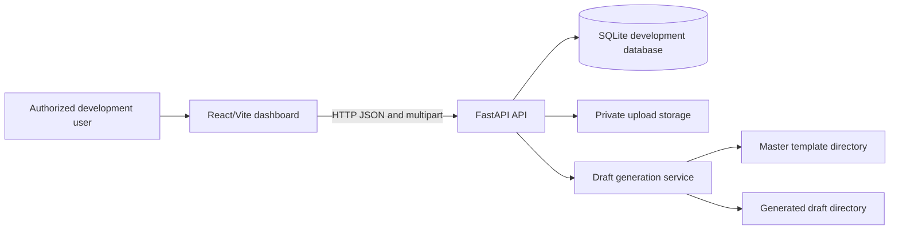
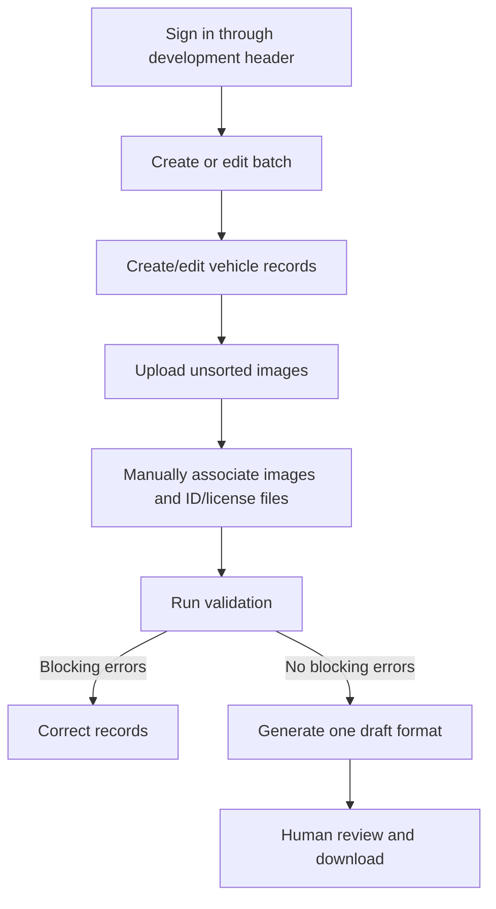
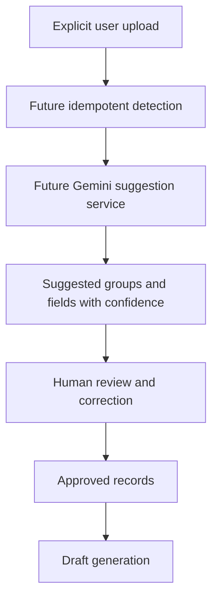
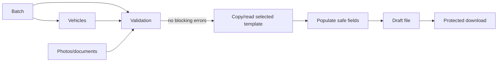

# System Architecture

- **Purpose:** Document the architecture that actually exists and separate it from planned architecture.
- **Status:** VERIFIED for the local development architecture.
- **Last updated:** 2026-10-16

## Current components

- **Frontend:** React, TypeScript, Vite, and CSS in `frontend/src/main.tsx` and `frontend/src/style.css`.
- **Backend:** FastAPI in `backend/app/main.py`.
- **Persistence:** SQLite through `backend/app/db.py`.
- **Services:** Validation and report generation in `backend/app/services/report_generator.py`.
- **Storage:** Generated drafts in `generated_drafts/`; private uploads in `storage/private/` or `GSCHPT_PRIVATE_STORAGE_DIR`; master templates in `templates/`.
- **External services:** None required by the current implementation.
- **Background processing:** None implemented.

**Diagram status: CURRENT.**

## Current user workflow

**Diagram status: CURRENT.**

## Planned AI-assisted workflow

**Diagram status: PLANNED.** No AI service is called by the current application.

## Report-generation data flow

**Diagram status:** Part current, part planned. Current fallback generation works; safe original-template field mapping is blocked until source templates are supplied.

## Authentication, authorization, and errors

The current development gate compares `X-Dev-User` with `GSCHPT_DEV_USERNAME`. Missing or incorrect values return `401`. It is not production identity management. Protected routes require the header; file paths are not exposed as public URLs. Validation returns blocking and review categories. Generation rejects blocking errors with `422`.

## Deployment architecture

Only local development has been verified: Vite on port 5173 and FastAPI on port 8000. Production PostgreSQL, object storage, HTTPS, identity, backups, and hosting are not configured.
